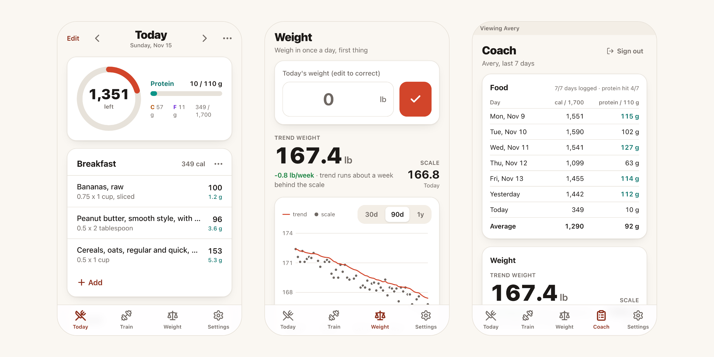
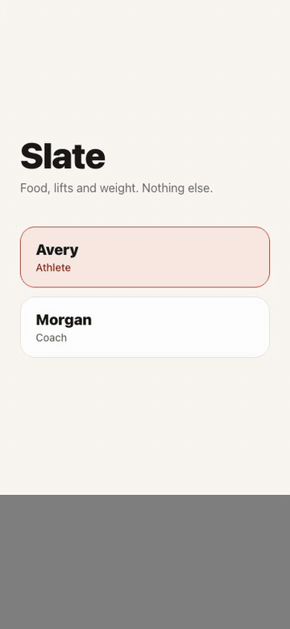
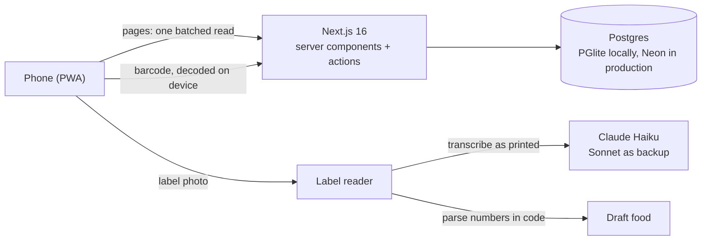

# Slate

[](https://github.com/Logan-Cope/slate-tracker/actions/workflows/ci.yml)

Food, lifts and body weight in one phone app. Calories and protein come first, the workout logger follows the program a coach writes, and the weight trend ignores day-to-day water noise. Snap a nutrition label and Claude fills in the food; that reader is held to an eval, written before it, whose bar is zero wrong calories.

**[Try the demo](https://slate-tracker-demo.vercel.app)**: tap Avery for the athlete's view or Morgan for the coach's. Everything in it is invented, it needs no account, and it resets itself.



## What it does

- **Food diary.** Search a USDA-based food list the way you'd say it ("150g chicken breast"), scan a barcode, or photograph a nutrition label. Go-to foods are ranked by what you usually eat at this hour.
- **Workouts.** The program's next routine is one tap away. The last session's weights show as a ghost, a set at that weight logs in one tap, the rest timer starts itself and personal records are flagged as they happen. A dropped connection loses nothing.
- **Weight trend.** A smoothed trend line and weekly rate, so a salty dinner doesn't read as a gained pound.
- **Coach view.** The athlete's last seven days at a glance, the targets, the program editor, and restaurant menus pulled from each chain's own published nutrition facts.

<p align="center"></p>

## How it works



- **One schema, two databases.** Postgres everywhere: PGlite (Postgres in WebAssembly) in the process for local dev, tests and the demo; Neon over HTTP in production. The unit tests run against real Postgres with nothing to install.
- **One round trip per page.** Each page sends all its reads as one batch, and a test holds every tab to a query count.
- **The model transcribes, code parses.** The label reader asks Claude to copy each line exactly as printed. Turning `<1g`, `0,8` and `1 oz (28g/about 15 chips)` into numbers is code with unit tests, not a prompt instruction.
- **Retries are free.** Every log, workout and set gets its id on the phone, so a resend is an upsert of the same rows.

More in [docs/ARCHITECTURE.md](docs/ARCHITECTURE.md), and how the AI features are measured in [docs/EVALS.md](docs/EVALS.md).

## Run it

Node 20.9 or later. No API keys or database needed.

```bash
git clone https://github.com/Logan-Cope/slate-tracker.git
cd slate-tracker
npm install
npm run demo        # http://localhost:3000, tap Avery or Morgan
```

The first page load compiles for about 13 seconds; later loads are fast.

`npm run demo` starts the app on an embedded Postgres, seeds 60 days of invented history and answers the label reader from a fixture. For a real deployment, copy `.env.example` to `.env.local` and set `AUTH_SECRET`, `SITE_PASSPHRASE`, `DATABASE_URL` and `ANTHROPIC_API_KEY`.

## Checks

```bash
npm run check       # typecheck, lint, the full unit suite on in-memory Postgres
npm run test:e2e    # 60 Playwright tests on an iPhone viewport, with tap-count budgets
npm run eval:labels # label reader against 16 synthetic photos (needs ANTHROPIC_API_KEY, about a cent)
```

CI runs the first two and a secret scan on every push.

## Stack

Next.js 16 (App Router, Server Actions), React 19, Tailwind 4, Drizzle, Postgres (PGlite and Neon), Auth.js 5, TanStack Query, zustand, zxing-wasm, Recharts, the Anthropic SDK, Vitest, Playwright, Vercel.

## Data

The food list is a subset of USDA FoodData Central, which is public domain. The packaged foods with barcodes, the people, the program, the history and the label photos are invented. `scripts/menustat-import.ts` can load MenuStat restaurant data; that data is not included.

## License

All rights reserved. The code is here to read and evaluate; see [LICENSE](LICENSE).
