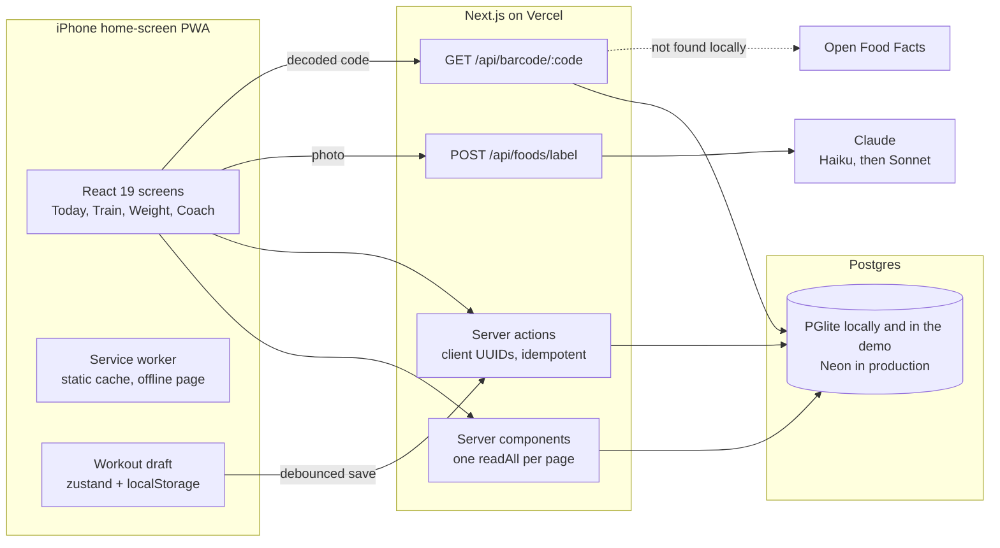
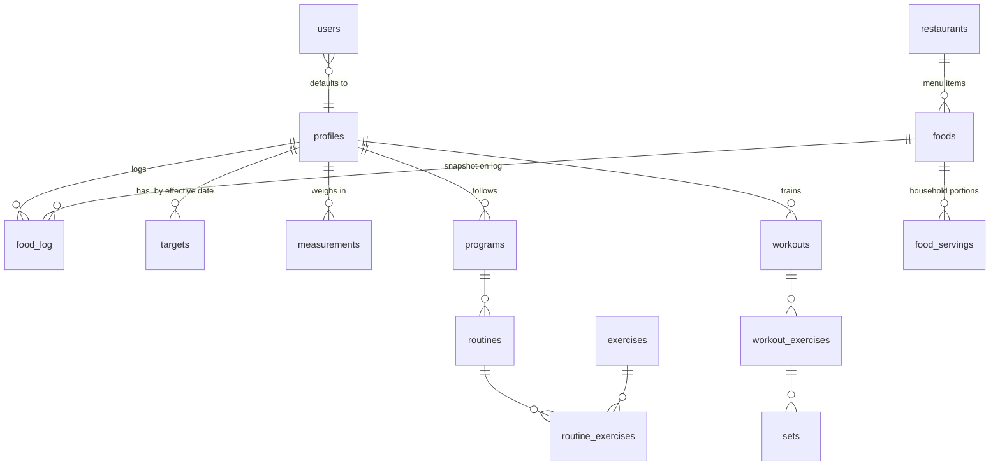
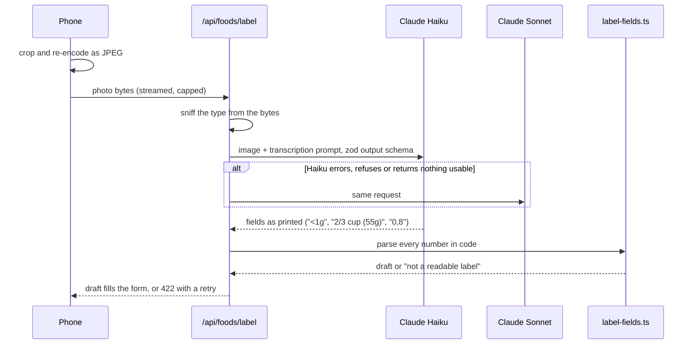

# Architecture

Slate is one Next.js 16 app (App Router, Server Actions, React 19) over one Postgres schema. Pages are server components that read through a small query layer; writes go through server actions; the two places that call a model sit behind a reader interface with a fixture stand-in.

## Storage: one schema, two drivers

`lib/db/client.ts` picks the driver from the environment. With `DATABASE_URL` set it is Neon over HTTP; without it, PGlite (Postgres compiled to WebAssembly) runs inside the Node process. Both are Drizzle instances over the same schema, so every query is written once and the unit tests run against real Postgres semantics (full-text search, `pg_trgm`, generated columns) with no server to start.

PGlite migrates and seeds itself on first use. The handle is opened once per process; while setup runs, requests that arrive wait on it, and the seed itself (which writes through the same query functions as the app) gets the handle through an `AsyncLocalStorage` context. That is what lets the hosted demo boot an empty in-memory database and fill it with 60 days of history on a cold start.

Every user-data table carries `profile_id`. A person is a profile row; a coach can view any profile, an athlete only their own (`lib/auth/session.ts`).

Foods store nutrients per label serving, never per 100 g, with conversions in `lib/nutrition/servings.ts`. A diary entry keeps a snapshot of what was eaten, so editing or deleting a food never rewrites history.

## One round trip per page

A page sends all its reads in one `readAll` (`lib/db/batch.ts`). On Neon that is one HTTPS request (`db.batch`, run as one transaction); on PGlite, plain queries. Queries that depend on an earlier result use a subquery instead of waiting for it. `tests/unit/page-queries.test.ts` holds every tab to a query count and a round-trip count, and `tests/unit/neon-batch.test.ts` runs the reads through the real Neon HTTP driver, answered by PGlite, to prove a batch returns exactly what separate requests return.

## Writes that survive a bad connection

Logs, workouts and sets get their ids on the phone (`crypto.randomUUID`). A retried save is an upsert of the same rows, so a flaky gym connection can resend freely. An active workout lives in a persisted zustand store and syncs on a debounce; the server stores the full draft and deletes rows the draft no longer has.

## Food search

`lib/db/queries/food-search.ts` is one SQL statement: full-text prefix matching for the words typed, a trigram fallback for typos, and a score that puts the person's own history first, then generic foods, then branded ones. Amounts typed into the box ("2 eggs", "150g chicken") are parsed in `lib/nutrition/quantity-parser.ts` and carried into the entry. `npm run eval:search` scores a golden set of queries against a full USDA import.

## Barcodes

The camera stream is decoded in the browser with `zxing-wasm`, served from this origin rather than a CDN, at 1080p so a label reads from a focusable distance. A code is looked up in the local database first, then in Open Food Facts. `tests/unit/scan-decode.test.ts` measures the decoder's limits on a synthetic camera, and the e2e suite feeds Chromium a generated video of a barcode.

## The label reader

A photo of a Nutrition Facts panel becomes a draft custom food.

Two choices carry the accuracy:

- **The model transcribes, code parses.** The prompt asks for each line exactly as printed. `"<1g"` becoming 0, comma decimals, milligrams to grams and splitting `"1 oz (28g/about 15 chips)"` into a measure and a weight are rules in `lib/nutrition/label-fields.ts` with unit tests, not prompt instructions a model may follow loosely.
- **Refusal is a valid answer.** A blurry, cut-off or wrong photo should come back as `readable: false`, and the eval counts a wrong calorie number that was filled in as worse than a refusal.

Haiku reads every photo; Sonnet is the backup when Haiku fails, with a 15 s timeout each inside the route's 45 s limit. The photo is never stored. How this was measured is in [EVALS.md](EVALS.md).

## Restaurant menus

A coach can add a chain by name. Claude, with the web search and web fetch server tools and a structured output, pulls the chain's own published nutrition facts; `lib/restaurants/validate.ts` checks every item (impossible calories, negative macros, more protein than the calories allow, repeated lines) and the coach reviews a draft before anything is saved. `npm run eval:restaurants` scores extraction against a golden menu.

## Weight trend

Daily weigh-ins are noisy. `lib/metrics/trend.ts` keeps the lowest reading per day, interpolates missing days and smooths with an exponential moving average (alpha 0.1), so the headline number and the weekly rate move with fat, not water.

## Demo mode

`DEMO_MODE=1` changes three things and nothing else:

1. The login screen offers the seeded athlete and coach as one-tap sign-ins (a separate credentials provider that only exists in demo mode).
2. An empty database is seeded with a USDA food list and 60 days of invented history ending today (`lib/demo/seed.ts`).
3. With no `ANTHROPIC_API_KEY`, the label reader and the menu finder answer from the same fixtures the e2e suite uses.

## The feedback loop (private build)

The private deployment this repo comes from has one more piece that is left out here because it is wired to a private repository: a feedback form in Settings files a GitHub issue; a Claude agent triages it; after a human approves with a label, a second agent implements it inside a sandbox (bubblewrap, no network, no credentials, writes only inside the checkout) and a separate job with its own token opens the pull request. A shell script checks the diff before anything is pushed: allowed folders only, no lockfiles, configs, workflows, binaries or hidden characters. CI runs on an agent's pull request only after a person has read the diff.

## Tests

| Layer | What | Count |
|---|---|---|
| Unit (Vitest) | Pure logic in `lib/`, query functions against in-memory PGlite, route handlers, copy rules | `npm run test` |
| End to end (Playwright) | iPhone viewport, tap-count budgets per flow, a synthetic camera for the scanner | 60 |
| Evals | Label reader, food search, restaurant extraction | see [EVALS.md](EVALS.md) |
